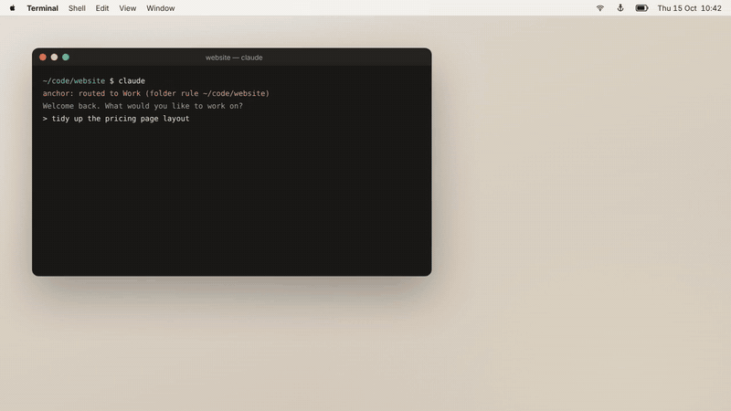
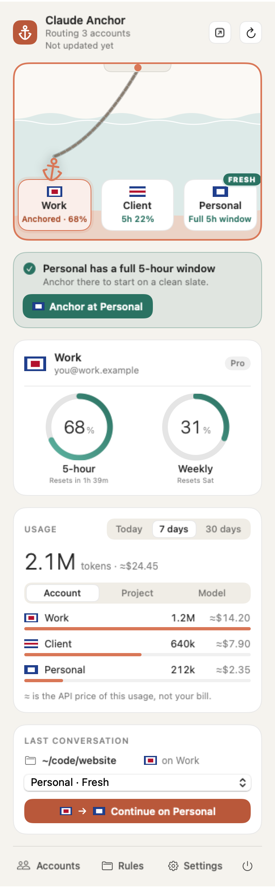
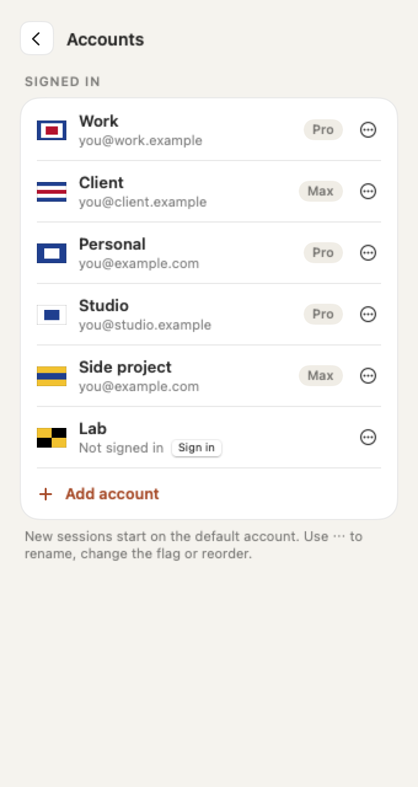
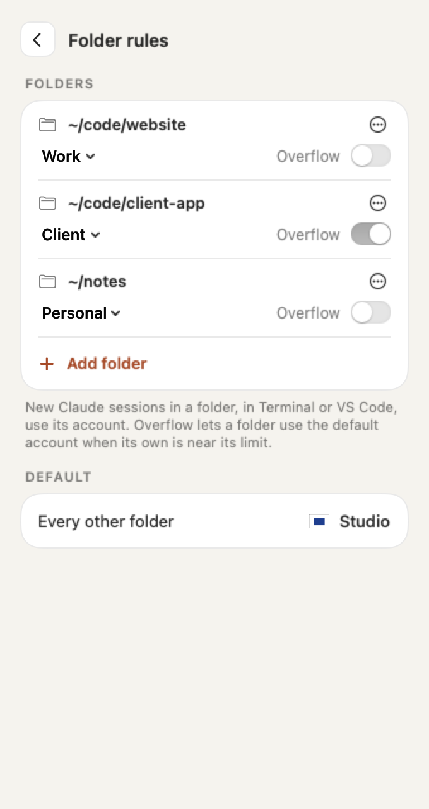

# Claude Anchor

A macOS menu bar app that routes Claude Code to the right Claude account for each folder, shows rate limits and usage, and continues a conversation on another account.



*With sound: [download the video](docs/brag-v0.3.mp4). Still frame: [`docs/brag-v0.3.jpg`](docs/brag-v0.3.jpg).*

| Menu | Accounts | Folder rules |
|---|---|---|
|  |  |  |

Dark mode, settings and first-run screens are in [`docs/`](docs/). These screenshots were taken before the 0.3 redesign. The tour above and the [user guide](docs/USER-GUIDE.md) show 0.3.

Unofficial and not affiliated with Anthropic. Free, MIT licensed, macOS 14+.

## What's new in 0.3

- **Clay redesign.** Warm paper (light) and charcoal (dark) surfaces with a clay-orange accent. Rings show the 5-hour and weekly limits. Bottom navigation: Accounts, Rules, Settings, Quit.
- **Drop anchor.** Drag the anchor onto an account's berth, or click a berth, to make it the default. Works with one account or ten.
- **Fresh resets.** An account whose 5-hour window has reset and is unused is marked fresh, with an optional notification.
- **Refresh control.** A refresh button, an "Updated" time, and intervals from every 30 seconds to manual only.
- **Pop-out window.** Move the full menu into its own resizable window, optionally kept on top.
- **Floating button.** A draggable, always-on-top button with usage at a glance and a quick panel.
- **Last conversation card.** Shows the conversation, the account it ran on, and one "Continue on <Name>" button.
- **Folder rules** show a status line when their account is near its limit.

The full list is in the [changelog](CHANGELOG.md). Task-by-task instructions are in the [user guide](docs/USER-GUIDE.md).

## Install

```sh
curl -fsSL https://raw.githubusercontent.com/SumithSB/claude-anchor/main/install.sh | bash
```

Or with Homebrew:

```sh
brew install --cask sumithsb/tap/claude-anchor
```

Prefer to read the script first:

```sh
curl -fsSLo install.sh https://raw.githubusercontent.com/SumithSB/claude-anchor/main/install.sh
less install.sh && bash install.sh
```

**What it touches, in short:** it reads Claude Code's logins from your Keychain only to show your limits, and sends them only to `api.anthropic.com`. It never copies or stores them. There's no telemetry or analytics. On disk it writes to `~/.claude-anchor`, one line in `~/.zshrc`, and one setting in your VS Code and Cursor settings (backed up first). Your existing `~/.claude` is never changed. The full list is under [Files it touches](#files-it-touches).

The app is ad-hoc signed, not notarized by Apple. The installer and the Homebrew cask clear the download quarantine so it opens normally. If you download the zip by hand, macOS blocks the first launch: open System Settings > Privacy & Security and click Open Anyway.

The installer downloads the latest release and verifies its SHA-256 checksum. If no release is available it builds from source. It installs the app to `/Applications` (or `~/Applications`), adds one line to `~/.zshrc` (skip with `CLAUDE_ANCHOR_NO_SHELL=1`) and launches the app.

### Build from source

```sh
git clone https://github.com/SumithSB/claude-anchor.git
cd claude-anchor
CLAUDE_ANCHOR_FROM_SOURCE=. ./install.sh
```

This builds, installs and adds the shell hook. `scripts/build.sh --install` only copies the app, so terminal `claude` isn't routed until you add `source ~/.claude-anchor/anchor.zsh` to `~/.zshrc`.

`scripts/package.sh` produces `dist/ClaudeAnchor-<version>.zip` and its `.sha256`.

## Upgrading

Homebrew users:

```sh
brew update && brew upgrade --cask claude-anchor
```

Curl installer users re-run the installer:

```sh
curl -fsSL https://raw.githubusercontent.com/SumithSB/claude-anchor/main/install.sh | bash
```

Settings and accounts live in `~/.claude-anchor` and are untouched by upgrades. Config files from earlier versions still load. The new keys are optional.

## Requirements

- macOS 14 or later
- [Claude Code](https://claude.ai/install.sh) CLI (`curl -fsSL https://claude.ai/install.sh | bash`)
- zsh for terminal routing (VS Code and Cursor routing works regardless)
- Swift toolchain (`xcode-select --install`) only for building from source

## How it works

- Each extra account gets its own `CLAUDE_CONFIG_DIR` under `~/.claude-anchor/accounts/`.
- Shared settings, skills and plugins are symlinked from `~/.claude` into each account dir.
- The primary account stays in `~/.claude`, with `CLAUDE_CONFIG_DIR` unset.
- `~/.claude-anchor/routes` maps folders to accounts (longest matching folder wins, plus a `default` line). A zsh `claude` function reads it and sets `CLAUDE_CONFIG_DIR` for the current folder.
- VS Code and Cursor are routed through `claudeCode.claudeProcessWrapper`, which points at a small wrapper script in `~/.claude-anchor/bin`.
- Limits come from Anthropic's OAuth usage endpoint, using the token Claude Code already keeps in the Keychain, read with `/usr/bin/security`. Tokens are never stored, logged, or sent anywhere except `api.anthropic.com`. The app never refreshes tokens; Claude Code does that.

## Using it

### Switch the default account (drop anchor)

The harbor switcher shows each account as a berth on a chain. The anchor marks the default account, which new sessions start on.

- Drag the anchor onto a berth to make that account the default.
- Click a berth and the anchor sails there.
- Arrow keys work too.

With a few accounts, every berth is roomy. With more, the berths get compact. Past about six, they scroll along a quay with arrows, and dragging toward an edge scrolls it. An Add berth appears when there is room. Long account names are truncated.

### Folder rules and overflow

Pin a folder, and its subfolders, to an account under **Rules**. The longest matching folder wins. Folders without a rule use the default. A rule shows a status line when its account is near its limit.

When the active account nears its limit, the default moves to one with headroom. If an account is over its limit, the overflow goes to a fresh account first when one is available.

### Reading the rings

The rings show the 5-hour and weekly limits. Teal means fine, amber starts at 75%, and red starts at 90%.

### Fresh resets

An account is **fresh** when its 5-hour window has reset and nothing has been used in the new window. A fresh account gives you a full window for free. You'll see it in four places:

- a teal FRESH badge on its berth,
- an "Anchor at <Name>" card in the popover,
- a teal dot on the floating button,
- a reset countdown on near-limit accounts, such as `92% · ↻ 22m`.

The app can also send a notification, "<Name>'s 5-hour window reset. Full window available." Turn it off with the fresh-reset notification setting (`notifyFresh`).

### Refresh

The refresh button in the header spins while it works. "Updated 2 min ago" sits under the title and turns amber when the data is outdated. The popover also refreshes when you open it if the data is more than 30 seconds old.

Choose how often limits refresh in **Settings > Refresh limits**: Live (every 30 s), 1 min, 5 min (default), 15 min, or Manual only. Live mode calls Anthropic's usage endpoint more often.

### Pop-out window

Pop the full menu out of the menu bar into its own resizable window. Turn on the "keep on top" pin to keep it above other windows. Use the Dock action to return it to the menu bar. While the window is open, Claude Anchor also shows a Dock icon.

### Floating button

The floating button is a round button you can drag anywhere. It stays above other windows.

- The ring shows the 5-hour usage of the default account.
- A flag badge marks the account.
- A teal dot means an account is fresh.
- A red badge means usage is 90% or more.

Click it for a quick panel with the limits, the fresh card, the harbor switcher and the continue card. Its settings are listed in the [settings reference](#settings-reference).

### Continue a conversation

The **Last conversation** card replaces the old Continue on menu. It shows the conversation's folder, the account it ran on, the last prompt for context, and a short explanation. It lists the other accounts, fresh ones first. Click **Continue on <Name>** to copy the transcript to that account and resume it in Terminal. A confirmation appears when it is done.

A running session keeps its account. Continuing starts a new process under the other account.

### Editors, history and checking accounts

- VS Code and Cursor are routed automatically: on first launch the app sets their Claude process wrapper (your settings are backed up first). New conversations follow the default account and folder rules; running ones keep their account. Turn it off in Settings > "Use in VS Code and Cursor".
- Conversation history is shared per folder: before `claude` starts (terminal or VS Code), the folder's conversations are synced across your accounts, so `--resume`, `-c` and the VS Code history list keep working after you switch. A copy is only ever extended, never overwritten if the two have diverged, and usage stays with the account that ran it. Set `CLAUDE_ANCHOR_NO_SYNC=1` to turn this off.
- To see which account a session uses, run `/status` in it, or check `$CLAUDE_ANCHOR_ACCOUNT`. Don't go by `~/.claude.json`: it always belongs to your primary account.

Bypass the shell function with `CLAUDE_ANCHOR_OFF=1` or by exporting `CLAUDE_CONFIG_DIR`. `anchor-which` prints what the current folder resolves to.

## Settings reference

Settings are in the app's **Settings** tab and are stored in `~/.claude-anchor/config.json`. Every key is optional, and older files still load without them.

| Setting | Config key | What it does |
|---|---|---|
| Refresh limits | `refreshSeconds` | How often limits refresh: 30 s (Live), 1 min, 5 min (default), 15 min, or Manual only. `0` means manual. |
| Fresh-reset notification | `notifyFresh` | Send a notification when an account's 5-hour window resets and is fresh. |
| Floating button | `floatingButton` | Show or hide the floating button. |
| Snap to screen edges | `floatingSnap` | Snap the floating button to the screen edges. |
| Fade when idle | `floatingFade` | Fade the floating button when it is idle. |
| Show on every Space | `floatingAllSpaces` | Keep the floating button visible on every Space. |
| Floating button position | `floatingX`, `floatingY` | Where the floating button sits. Set by dragging it, and remembered. |

The VS Code and Cursor switch is described under [Editors, history and checking accounts](#editors-history-and-checking-accounts).

## Privacy

No telemetry. The only network traffic is to the usage endpoint on `api.anthropic.com`.

## Files it touches

| Path | Purpose |
| --- | --- |
| `~/.claude-anchor/` | config (including `config.json`), routes, usage history, shell shim, editor wrapper |
| `~/.claude-anchor/accounts/` | one config dir per extra account |
| `~/.zshrc` | one marked line, added by the installer |
| VS Code / Cursor `settings.json` | `claudeCode.claudeProcessWrapper`, set on first launch, removed when you turn it off (backup: `settings.json.anchor-backup`) |
| `~/.claude/` | read only (transcripts); settings, skills and plugins are symlinked from it |
| Keychain | read only, Claude Code's own items |

## Uninstall

```sh
curl -fsSL https://raw.githubusercontent.com/SumithSB/claude-anchor/main/uninstall.sh | bash
```

It removes the app, the `~/.zshrc` line and the editor setting (with backups), then asks before deleting `~/.claude-anchor`. Extra accounts' history lives in `~/.claude-anchor/accounts`, and their Keychain logins stay until removed in the app or with `security delete-generic-password -s "Claude Code-credentials-<hash>"`. `~/.claude` is never touched.

## Limitations

- Unofficial; not affiliated with or endorsed by Anthropic.
- Relies on undocumented Claude Code behaviour that may change: Keychain service naming, the usage endpoint, and the transcript layout.
- A running session can't change account. Claude Code picks its config dir and Keychain login once, at startup, and nothing outside the process can change that. Changing the default account or a folder rule affects new sessions only. To move a conversation, use **Continue on <Name>** in the Last conversation card, which copies the transcript and resumes it in a new process (in Terminal). Running `/login` inside a session replaces that account's login; it doesn't switch accounts.
- Ad-hoc signed, not notarized. The installer clears the quarantine flag; a manually downloaded zip may need right-click, Open.

## Roadmap

Planned, not yet supported:

- **Other operating systems:** Linux and Windows, with a tray app and routing for bash, fish and PowerShell.
- **Other coding agents:** Codex CLI, Gemini CLI, Cursor Agent and other agent CLIs, with the same folder rules and usage view.
- **Other providers:** OpenAI, Google and other model providers' accounts and API keys, side by side with Claude accounts.

Ideas and pull requests are welcome in [Issues](https://github.com/SumithSB/claude-anchor/issues).

## Acknowledgements

- [claude-swap](https://github.com/realiti4/claude-swap) by realiti4, the account switcher that inspired this project. Claude Anchor takes a different approach (one config folder per account instead of swapping credentials), but the idea started there.
- [brag](https://github.com/latent-spaces/brag) by Latent Spaces, used to make the launch video above.

## License

[MIT](LICENSE)
