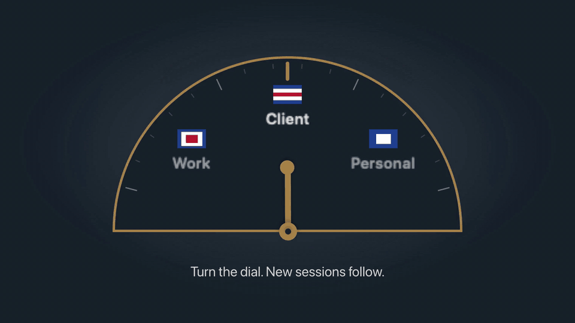

# Claude Anchor

A macOS menu bar app that routes Claude Code to the right Claude account for each folder, shows rate limits and usage, and continues a conversation on another account.



*With sound: [download the video](https://github.com/SumithSB/claude-anchor/raw/main/docs/brag.mp4).*

| Menu | Accounts | Folder rules |
|---|---|---|
|  |  |  |

Dark mode, settings and first-run screens are in [`docs/`](docs/).

## Install

```sh
curl -fsSL https://raw.githubusercontent.com/SumithSB/claude-anchor/main/install.sh | bash
```

The installer downloads the latest release and verifies its SHA-256 checksum. If no release is available it builds from source. It installs the app to `/Applications` (or `~/Applications`), adds one line to `~/.zshrc` (skip with `CLAUDE_ANCHOR_NO_SHELL=1`) and launches the app.

### Build from source

```sh
git clone https://github.com/SumithSB/claude-anchor.git
cd claude-anchor
CLAUDE_ANCHOR_FROM_SOURCE=. ./install.sh
```

This builds, installs and adds the shell hook. `scripts/build.sh --install` only copies the app, so terminal `claude` isn't routed until you add `source ~/.claude-anchor/anchor.zsh` to `~/.zshrc`.

`scripts/package.sh` produces `dist/ClaudeAnchor-<version>.zip` and its `.sha256`.

## Requirements

- macOS 14 or later
- [Claude Code](https://claude.ai/install.sh) CLI (`curl -fsSL https://claude.ai/install.sh | bash`)
- zsh for terminal routing (VS Code and Cursor routing works regardless)
- Swift toolchain (`xcode-select --install`) only for building from source

## How it works

- Each extra account gets its own `CLAUDE_CONFIG_DIR` under `~/.claude-anchor/accounts/`.
- Shared settings, skills and plugins are symlinked from `~/.claude` into each account dir.
- The primary account stays in `~/.claude`, with `CLAUDE_CONFIG_DIR` unset.
- `~/.claude-anchor/routes` maps folders to accounts (longest matching folder wins, plus a `default` line). A zsh `claude` function reads it and sets `CLAUDE_CONFIG_DIR` for the current folder.
- VS Code and Cursor are routed through `claudeCode.claudeProcessWrapper`, which points at a small wrapper script in `~/.claude-anchor/bin`.
- Limits come from Anthropic's OAuth usage endpoint, using the token Claude Code already keeps in the Keychain, read with `/usr/bin/security`. Tokens are never stored, logged, or sent anywhere except `api.anthropic.com`. The app never refreshes tokens; Claude Code does that.

## Using it

- **Dial:** choose which account new sessions start on.
- **Folder rules:** pin a folder (and its subfolders) to an account.
- **Auto-switch:** when the active account nears its limit, the default moves to one with headroom.
- **Continue on another account:** pick a conversation and continue it in Terminal under a different account.
- **Usage:** by account, project and model. The dollar figure marked "≈" is the API price of the tokens, not your bill.
- VS Code and Cursor are routed automatically: on first launch the app sets their Claude process wrapper (your settings are backed up first). New conversations follow the dial and folder rules; running ones keep their account. Turn it off in Settings > "Use in VS Code and Cursor".
- Conversation history is shared per folder: before `claude` starts (terminal or VS Code), the folder's conversations are synced across your accounts, so `--resume`, `-c` and the VS Code history list keep working after you switch. A copy is only ever extended, never overwritten if the two have diverged, and usage stays with the account that ran it. Set `CLAUDE_ANCHOR_NO_SYNC=1` to turn this off.
- To see which account a session uses, run `/status` in it, or check `$CLAUDE_ANCHOR_ACCOUNT`. Don't go by `~/.claude.json`: it always belongs to your primary account.

Bypass the shell function with `CLAUDE_ANCHOR_OFF=1` or by exporting `CLAUDE_CONFIG_DIR`. `anchor-which` prints what the current folder resolves to.

## Privacy

No telemetry. The only network traffic is to the usage endpoint on `api.anthropic.com`.

## Files it touches

| Path | Purpose |
| --- | --- |
| `~/.claude-anchor/` | config, routes, usage history, shell shim, editor wrapper |
| `~/.claude-anchor/accounts/` | one config dir per extra account |
| `~/.zshrc` | one marked line, added by the installer |
| VS Code / Cursor `settings.json` | `claudeCode.claudeProcessWrapper`, set on first launch, removed when you turn it off (backup: `settings.json.anchor-backup`) |
| `~/.claude/` | read only (transcripts); settings, skills and plugins are symlinked from it |
| Keychain | read only, Claude Code's own items |

## Uninstall

```sh
curl -fsSL https://raw.githubusercontent.com/SumithSB/claude-anchor/main/uninstall.sh | bash
```

It removes the app, the `~/.zshrc` line and the editor setting (with backups), then asks before deleting `~/.claude-anchor`. Extra accounts' history lives in `~/.claude-anchor/accounts`, and their Keychain logins stay until removed in the app or with `security delete-generic-password -s "Claude Code-credentials-<hash>"`. `~/.claude` is never touched.

## Limitations

- Unofficial; not affiliated with or endorsed by Anthropic.
- Relies on undocumented Claude Code behaviour that may change: Keychain service naming, the usage endpoint, and the transcript layout.
- A running session can't change account. Claude Code picks its config dir and Keychain login once, at startup, and nothing outside the process can change that. Switching the dial or a folder rule affects new sessions only. To move a conversation, use **Continue on another account**, which copies the transcript and resumes it in a new process (in Terminal). Running `/login` inside a session replaces that account's login; it doesn't switch accounts.
- Ad-hoc signed, not notarized. The installer clears the quarantine flag; a manually downloaded zip may need right-click, Open.

## Roadmap

Planned, not yet supported:

- **Other operating systems:** Linux and Windows, with a tray app and routing for bash, fish and PowerShell.
- **Other coding agents:** Codex CLI, Gemini CLI, Cursor Agent and other agent CLIs, with the same folder rules and usage view.
- **Other providers:** OpenAI, Google and other model providers' accounts and API keys, side by side with Claude accounts.

Ideas and pull requests are welcome in [Issues](https://github.com/SumithSB/claude-anchor/issues).

## Acknowledgements

- [claude-swap](https://github.com/realiti4/claude-swap) by realiti4, the account switcher that inspired this project. Claude Anchor takes a different approach (one config folder per account instead of swapping credentials), but the idea started there.
- [brag](https://github.com/latent-spaces/brag) by Latent Spaces, used to make the launch video above.

## License

[MIT](LICENSE)
