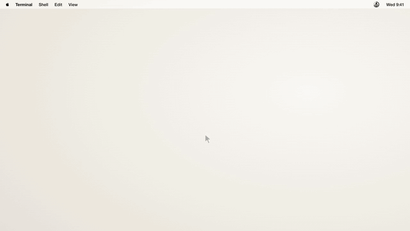
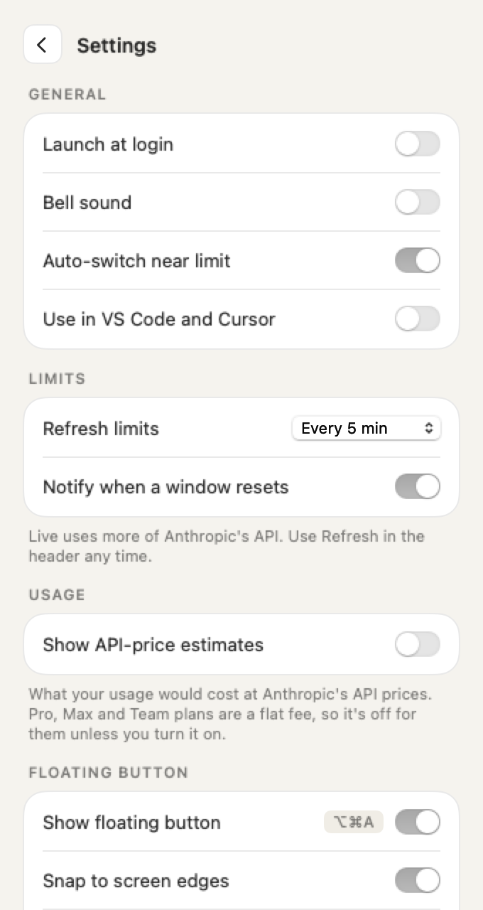
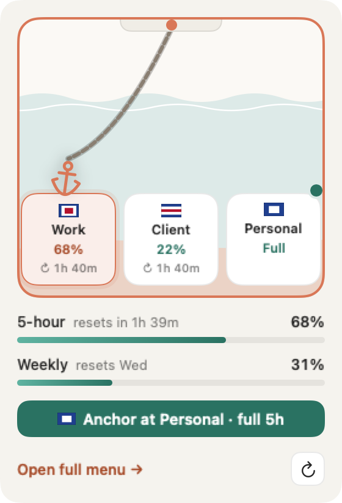

# Claude Anchor

An app for macOS, Windows and Linux that routes Claude Code to the right Claude account for each folder, shows rate limits and usage, and continues a conversation on another account. Use it from the menu bar (or the system tray on Windows and Linux), a floating button, or a pop-out panel. The screenshots show the macOS app.



*[Download the video with sound](docs/tour.mp4). Still frame: [`docs/tour.jpg`](docs/tour.jpg).*

| Menu | Accounts | Folder rules |
|---|---|---|
|  |  |  |

| Settings | Floating button | Glance card |
|---|---|---|
|  |  |  |

The screenshots are taken from the current build. Dark mode, six accounts, first-run and sign-in screens are also in [`docs/`](docs/).

Unofficial and not affiliated with Anthropic. Free, MIT licensed. macOS 14+, Windows 10/11 (x64) and Linux (x86_64).

## What's new in 0.5

- **Reset times on every berth.** Each account shows when its 5-hour window resets ("resets in 1h 39m"), so you can see which account frees up next.
- **No dollar figures on subscription plans.** Pro, Max and Team are a flat fee, so the Usage card shows tokens only. Turn on **Settings > Usage > Show API-price estimates** to see the API price. Estimates use current API prices, including Opus 5.5, Sonnet 5, Haiku 5.5 and 1-hour cache writes.
- **Continue from VS Code and Cursor.** Continue anchors at the other account, then **Reopen in VS Code** brings the conversation back on it with its history.
- **Lighter.** The pop-out uses about a quarter of the memory and a sixth of the CPU it did. One failed limits check no longer shows a warning, and limits from a window that has since reset read as unused.

## What's new in 0.4

- **Windows and Linux.** A tray app with the same harbor switcher, limit rings, usage, last conversation card, Accounts, Rules and Settings panes, and floating button. Install with [`install.ps1`](#windows) or [`install.sh`](#linux).
- **`anchor` command line** on Windows and Linux for routing, limits, usage, accounts, rules and Continue from a terminal. See [Command line](#command-line-windows-and-linux).
- **Routing beyond zsh.** On Windows and Linux, `claude` is routed in bash, zsh and PowerShell, and in VS Code and Cursor.

## What's new in 0.3

- **Clay redesign.** Warm paper (light) and charcoal (dark) surfaces with a clay-orange accent. Rings show the 5-hour and weekly limits. Bottom navigation: Accounts, Rules, Settings, Quit.
- **Drop anchor.** Drag the anchor onto an account's berth, or click a berth, to make it the default. Works with one account or ten.
- **Fresh resets.** An account whose 5-hour window has reset and is unused is marked fresh, with an optional notification.
- **Refresh control.** A refresh button, an "Updated" time, and intervals from every 30 seconds to manual only.
- **Pop-out window.** Move the full menu into a small floating panel that stays on top and doesn't take focus.
- **Floating button.** A small round button, on by default, with usage at a glance. Click it for a glance card.
- **Last conversation card.** Shows the conversation's folder, an account menu and one "Continue on <Name>" button.
- **Folder rules** show a status line when their account is near its limit.

The full list is in the [changelog](CHANGELOG.md). Task-by-task instructions are in the [user guide](docs/USER-GUIDE.md).

## Install

### macOS

```sh
curl -fsSL https://raw.githubusercontent.com/SumithSB/claude-anchor/main/install.sh | bash
```

Or with Homebrew:

```sh
brew install --cask sumithsb/tap/claude-anchor
```

Prefer to read the script first:

```sh
curl -fsSLo install.sh https://raw.githubusercontent.com/SumithSB/claude-anchor/main/install.sh
less install.sh && bash install.sh
```

**What it touches, in short (macOS):** it reads Claude Code's logins from your Keychain only to show your limits, and sends them only to `api.anthropic.com`. It never copies or stores them. There's no telemetry or analytics. On disk it writes to `~/.claude-anchor`, one line in `~/.zshrc`, and one setting in your VS Code and Cursor settings (backed up first). Your existing `~/.claude` is never changed. On Windows and Linux it reads the same logins from Claude Code's own `.credentials.json` instead, and adds its line to your bash, zsh or PowerShell profile. The full list is under [Files it touches](#files-it-touches).

The app is ad-hoc signed, not notarized by Apple. The installer and the Homebrew cask clear the download quarantine so it opens normally. If you download the zip by hand, macOS blocks the first launch: open System Settings > Privacy & Security and click Open Anyway.

The installer downloads the latest release and verifies its SHA-256 checksum. If no release is available it builds from source. It installs the app to `/Applications` (or `~/Applications`), adds one line to `~/.zshrc` (skip with `CLAUDE_ANCHOR_NO_SHELL=1`) and launches the app.

### Build from source

```sh
git clone https://github.com/SumithSB/claude-anchor.git
cd claude-anchor
CLAUDE_ANCHOR_FROM_SOURCE=. ./install.sh
```

This builds, installs and adds the shell hook. `scripts/build.sh --install` only copies the app, so terminal `claude` isn't routed until you add `source ~/.claude-anchor/anchor.zsh` to `~/.zshrc`.

`scripts/package.sh` produces `dist/ClaudeAnchor-<version>.zip` and its `.sha256`.

### Windows

```powershell
irm https://raw.githubusercontent.com/SumithSB/claude-anchor/main/install.ps1 | iex
```

Needs 64-bit Windows 10 or 11 and PowerShell 5.1 or later. The installer downloads the latest release, verifies its SHA-256 checksum, installs the app for your user, and adds one marked line (`# claude-anchor`) to each PowerShell profile. Skip the profile line with `CLAUDE_ANCHOR_NO_SHELL=1`.

The build is unsigned, so Windows SmartScreen may stop the first launch with "Windows protected your PC". Click **More info**, then **Run anyway**.

Open a new terminal after install so `claude` is routed.

### Linux

```sh
curl -fsSL https://raw.githubusercontent.com/SumithSB/claude-anchor/main/install.sh | bash
```

Needs x86_64. The installer downloads the AppImage and the `anchor` CLI from the latest release and verifies both checksums. Other architectures, or a machine with no usable release, build from source. That needs Rust and the packages listed in [`cross/tray/README.md`](cross/tray/README.md).

- **Tray.** GNOME needs the AppIndicator extension to show the tray icon. The tray sends no click events on Linux, so open the app from the tray's menu (**Open**).
- **AppImage.** It needs FUSE 2 (`libfuse2`) to run.
- **Wayland.** There is no floating button and no Ctrl+Alt+A hotkey. Use the tray menu.

Open a new terminal after install so the shell hook loads.

`CLAUDE_ANCHOR_NO_SHELL=1` skips the shell hook lines in `~/.bashrc` and `~/.zshrc`.

## Upgrading

Homebrew users:

```sh
brew update && brew upgrade --cask claude-anchor
```

The upgrade quits Claude Anchor. Open it again from Applications (or Spotlight) afterwards.

Curl installer users re-run the installer. It quits the running app, installs the new version and opens it:

```sh
curl -fsSL https://raw.githubusercontent.com/SumithSB/claude-anchor/main/install.sh | bash
```

`brew upgrade` only knows about apps Homebrew installed. If it says `Cask 'claude-anchor' is not installed`, the app came from the curl installer, a downloaded zip or a source build. Either re-run the installer above, or switch to Homebrew so `brew upgrade` works from then on:

```sh
brew install --cask --force sumithsb/tap/claude-anchor
```

`--force` replaces the app already in `/Applications`, which Homebrew otherwise refuses to overwrite.

Settings and accounts live in `~/.claude-anchor` and are untouched by upgrades. Config files from earlier versions still load. The new keys are optional.

## Requirements

- macOS 14 or later, Windows 10/11 (64-bit), or Linux (x86_64)
- [Claude Code](https://claude.ai/install.sh) CLI (`curl -fsSL https://claude.ai/install.sh | bash`). On Windows: `irm https://claude.ai/install.ps1 | iex`
- zsh for terminal routing on macOS (VS Code and Cursor routing works regardless). Windows routes PowerShell; Linux routes bash and zsh.
- Swift toolchain (`xcode-select --install`) only for building from source on macOS. Rust and the Tauri packages in [`cross/tray/README.md`](cross/tray/README.md) for building on Windows or Linux.

## How it works

- Each extra account gets its own `CLAUDE_CONFIG_DIR` under `~/.claude-anchor/accounts/`.
- Shared settings, skills and plugins are symlinked from `~/.claude` into each account dir.
- The primary account stays in `~/.claude`, with `CLAUDE_CONFIG_DIR` unset.
- `~/.claude-anchor/routes` maps folders to accounts (longest matching folder wins, plus a `default` line). A zsh `claude` function reads it and sets `CLAUDE_CONFIG_DIR` for the current folder.
- VS Code and Cursor are routed through `claudeCode.claudeProcessWrapper`, which points at a small wrapper script in `~/.claude-anchor/bin`.
- Limits come from Anthropic's OAuth usage endpoint, using the token Claude Code already keeps: in the Keychain on macOS, read with `/usr/bin/security`, and in `<config dir>/.credentials.json` on Windows and Linux. Tokens are never stored, logged, or sent anywhere except `api.anthropic.com`. The app never refreshes tokens; Claude Code does that.

## Using it

### Switch the default account (drop anchor)

The harbor switcher shows each account as a berth on a chain. The anchor marks the default account, which new sessions start on.

- Drag the anchor onto a berth to make that account the default.
- Click a berth and the anchor sails there.
- Arrow keys work too.

With a few accounts, every berth is roomy. With more, the berths get compact. Past about six, they scroll along a quay with arrows, and dragging toward an edge scrolls it. An Add berth appears when there is room. Long account names are truncated.

### Folder rules and overflow

Send a folder, and its subfolders, to an account under **Rules**. Each rule is a row in the Folders card: the folder, an account menu, an **Overflow** switch and a ⋯ menu. Click **Add folder**, or drop a folder onto that row. The **Default** card shows the account every other folder uses. The longest matching folder wins. A rule shows a status line when its account is near its limit.

Overflow lets a folder use the default account when its own account is near its limit.

When the active account nears its limit, the default moves to one with headroom. If an account is over its limit, the overflow goes to a fresh account first when one is available.

### The menu

The menu bar window is a fixed height and scrolls. From top to bottom: the header with the pop-out and refresh buttons, the harbor switcher, the fresh card when an account has a full 5-hour window, the default account's card with its 5-hour and weekly rings, the Usage card, and the Last conversation card. The bottom bar has **Accounts**, **Rules**, **Settings** and a Quit button.

**Accounts**, **Rules** and **Settings** open as panes with a back button. In **Accounts**, the Signed in card lists every account, with **Add account** as the last row. Use an account's ⋯ menu to rename it, change its flag, or reorder it with **Move up** and **Move down**.

### Reading the rings

The rings show the 5-hour and weekly limits. Teal means fine, amber starts at 75%, and red starts at 90%.

### Fresh resets

An account is **fresh** when its 5-hour window has reset and nothing has been used in the new window. A fresh account gives you a full window for free. This applies to the account you're on as well as the others. You'll see it in these places:

- a teal FRESH badge on its berth,
- in the menu, a "Full 5-hour window on" card with a chip per fresh account (click one to anchor there; on Windows and Linux, an "Anchor at <Name>" button), or, when only the account you're on is fresh, a teal "<Name> has a full 5-hour window" card that says your limit just reset,
- a teal glow and ↻ badge on the floating button.

Every other berth shows when its 5-hour window resets, such as "resets in 1h 39m", so you can see which account frees up next.

The app can also send a notification: "<Name>'s 5-hour window reset. Full window available." for another account, or "<Name>'s 5-hour window reset. You're on a full window." for the account you're on. Turn it off with the fresh-reset notification setting (`notifyFresh`).

### Refresh

The refresh button in the header spins while it works. "Updated 2 min ago" sits under the title and turns amber when the data is outdated. The popover also refreshes when you open it if the data is more than 30 seconds old.

Choose how often limits refresh in **Settings > Refresh limits**: Live (every 30 s), 1 min, 5 min (default), 15 min, or Manual only. Live mode calls Anthropic's usage endpoint more often.

### Pop-out window

Click the pop-out button in the header to move the full menu into a small floating panel. It stays above other windows, doesn't take focus from the app you're in, and adds no Dock icon. Close it to return to the menu bar.

### Floating button

The floating button is on by default. It is a 44 pt round button that starts at the bottom right of the screen. Drag it anywhere; it stays above other windows. Show or hide it in **Settings > Floating button**, or press ⌥⌘A.

- The ring shows the 5-hour usage of the default account.
- A flag badge marks the account.
- A teal glow (it pulses a few times, then stays) and ↻ badge mean the account you're on, or another account, has a full 5-hour window.
- A red badge means usage is 90% or more.

Hover for a tooltip with the account and its usage (it adds "full 5h window" when the account you're on is fresh). Click it for a small glance card:

- the harbor, to switch accounts,
- the 5-hour and weekly bars,
- "<Name> has a full 5-hour window" when the account you're on is fresh,
- an **Anchor at <Name> · full 5h** button when another account has a fresh 5-hour window,
- **Open full menu →**, which opens the menu bar menu, and a refresh button.

Its settings are listed in the [settings reference](#settings-reference).

### Continue a conversation

The **Last conversation** card replaces the old Continue on menu. It shows the conversation's folder and one account menu, with fresh accounts first. Pick an account and click **Continue on <Name>**. The app copies the transcript to that account and resumes it in a new Terminal tab. A confirmation appears when it is done. For a conversation that ran in VS Code or Cursor (macOS), it makes that account the default instead: close the conversation's tab, then click **Reopen in VS Code**.

A running session keeps its account. Continuing starts a new process under the other account.

### Editors, history and checking accounts

- VS Code and Cursor are routed automatically: on first launch the app sets their Claude process wrapper (your settings are backed up first). New conversations follow the default account and folder rules; running ones keep their account. Turn it off in Settings > "Use in VS Code and Cursor".
- Conversation history is shared per folder: before `claude` starts (terminal or VS Code), the folder's conversations are synced across your accounts, so `--resume`, `-c` and the VS Code history list keep working after you switch. A copy is only ever extended, never overwritten if the two have diverged, and usage stays with the account that ran it. Set `CLAUDE_ANCHOR_NO_SYNC=1` to turn this off.
- To see which account a session uses, run `/status` in it, or check `$CLAUDE_ANCHOR_ACCOUNT`. Don't go by `~/.claude.json`: it always belongs to your primary account.

Bypass the shell function with `CLAUDE_ANCHOR_OFF=1` or by exporting `CLAUDE_CONFIG_DIR`. `anchor-which` prints what the current folder resolves to.

## Command line (Windows and Linux)

The `anchor` CLI is installed to `~/.claude-anchor/bin/anchor` (`%USERPROFILE%\.claude-anchor\bin\anchor.exe` on Windows). The installer does not add that folder to your PATH, so use the full path or add the folder yourself. The CLI and the tray app read and write the same files, so a change made in one shows in the other.

```
anchor exec -- <program> [args...]    run a program routed for the current folder
anchor which [dir]                    config dir used for a folder
anchor status                         accounts, rules and limits
anchor limits [--json]                5-hour and weekly limits
anchor usage [--by account|project|model] [--days N]
anchor account list | add <name> | login <id> | remove <id> [--to <id>] | rename <id> <name>
anchor default <id>
anchor rule list | add <folder> <account> [--overflow] | remove <folder>
anchor editor on|off                  VS Code / Cursor integration
anchor continue <account>             continue the last conversation on another account
anchor install | uninstall            shell hook, binaries, editor integration
```

`anchor help` prints this list, and `anchor version` prints the version.

`claude` is routed automatically in bash, zsh and PowerShell. In cmd.exe or fish, run Claude through the CLI instead: `anchor exec -- claude`.

## Settings reference

Settings are in the app's **Settings** pane, in three cards: General, Limits and Floating button. They are stored in `~/.claude-anchor/config.json`. Every key is optional, and older files still load without them.

| Setting | Config key | Default | What it does |
|---|---|---|---|
| Refresh limits | `refreshSeconds` | 5 min | How often limits refresh: 30 s (Live), 1 min, 5 min, 15 min, or Manual only. `0` means manual. |
| Fresh-reset notification | `notifyFresh` | On | Send a notification when an account's 5-hour window resets and is fresh, including the account you're on. |
| API-price estimates | `showAPIPrices` | Off on Pro, Max and Team | Show what usage would cost at API prices in the Usage card. On by default only when an account has no subscription plan. |
| Floating button | `floatingButton` | On | Show or hide the floating button. |
| Snap to screen edges | `floatingSnap` | On | Snap the floating button to the screen edges. |
| Fade when idle | `floatingFade` | Off | Fade the floating button when it is idle. |
| Show on every Space | `floatingAllSpaces` | On | Keep the floating button visible on every Space. |
| Floating button position | `floatingX`, `floatingY` | Bottom right | Where the floating button sits. Set by dragging it, and remembered. |

The VS Code and Cursor switch is described under [Editors, history and checking accounts](#editors-history-and-checking-accounts).

## Privacy

No telemetry. The only network traffic is to the usage endpoint on `api.anthropic.com`.

## Files it touches

| Path | Purpose |
| --- | --- |
| `~/.claude-anchor/` | config (including `config.json`), routes, usage history, shell shim, editor wrapper |
| `~/.claude-anchor/accounts/` | one config dir per extra account |
| `~/.zshrc` | one marked line, added by the installer |
| VS Code / Cursor `settings.json` | `claudeCode.claudeProcessWrapper`, set on first launch, removed when you turn it off (backup: `settings.json.anchor-backup`) |
| `~/.claude/` | read only (transcripts); settings, skills and plugins are symlinked from it |
| Keychain | read only, Claude Code's own items |

The macOS list above is the full set. Windows and Linux touch these paths instead:

**Linux**

- `~/.claude-anchor/`: config, routes, usage history, `bin/anchor` and `bin/claude-wrapper`, and `accounts/`.
- `~/.bashrc` and `~/.zshrc`: one marked line each, if the file exists. If neither exists, `~/.bashrc` is created.
- `~/.config/<editor>/User/settings.json` for VS Code, Cursor, Code - Insiders and VSCodium, if the file exists. `XDG_CONFIG_HOME` is respected. Backup: `settings.json.anchor-backup`.
- `~/.local/bin/claude-anchor.AppImage`: the app.
- `~/.local/share/applications/claude-anchor.desktop`: the menu entry.
- An autostart `.desktop` file in `~/.config/autostart`, when Start at login is on.

**Windows**

- `%USERPROFILE%\.claude-anchor\`: config, routes, usage history, `bin\anchor.exe` and `bin\claude-wrapper.exe`, and `accounts\`.
- `Documents\PowerShell` and `Documents\WindowsPowerShell`: `Microsoft.PowerShell_profile.ps1` in each, with one marked line. Each profile is created if missing.
- `%APPDATA%\<editor>\User\settings.json` for VS Code, Cursor, Code - Insiders and VSCodium, if the file exists. Backup: `settings.json.anchor-backup`.
- `%LOCALAPPDATA%\Claude Anchor\`: the per-user app install.
- `HKCU\Software\Microsoft\Windows\CurrentVersion\Run`, a "Claude Anchor" value, when Start at login is on.

**Credentials on Windows and Linux** are read from `.credentials.json` in each account's config folder (`~/.claude` for the primary account, `~/.claude-anchor/accounts/<id>` for the others). That is Claude Code's own file. The app reads the token for the usage check and sends it only to `api.anthropic.com`. It does not copy or store it.

## Uninstall

### macOS

```sh
curl -fsSL https://raw.githubusercontent.com/SumithSB/claude-anchor/main/uninstall.sh | bash
```

It removes the app, the `~/.zshrc` line and the editor setting (with backups), then asks before deleting `~/.claude-anchor`. Extra accounts' history lives in `~/.claude-anchor/accounts`, and their Keychain logins stay until removed in the app or with `security delete-generic-password -s "Claude Code-credentials-<hash>"`. `~/.claude` is never touched.

### Windows

```powershell
irm https://raw.githubusercontent.com/SumithSB/claude-anchor/main/uninstall.ps1 | iex
```

Removes the app, the PowerShell profile lines and the editor setting. `~/.claude-anchor` is kept, and `~/.claude` is not touched.

### Linux

```sh
curl -fsSL https://raw.githubusercontent.com/SumithSB/claude-anchor/main/uninstall.sh | bash
```

Removes the app, the `.desktop` entries, the autostart entry, the shell hook lines and the editor setting. `~/.claude-anchor` is kept, and `~/.claude` is not touched.

## Limitations

- Unofficial; not affiliated with or endorsed by Anthropic.
- Relies on undocumented Claude Code behaviour that may change: Keychain service naming, the `.credentials.json` location on Windows and Linux, the usage endpoint, and the transcript layout.
- A running session can't change account. Claude Code picks its config dir and Keychain login once, at startup, and nothing outside the process can change that. Changing the default account or a folder rule affects new sessions only. To move a conversation, use **Continue on <Name>** in the Last conversation card, which copies the transcript and resumes it in a new process (in Terminal, or in a reopened VS Code tab). Running `/login` inside a session replaces that account's login; it doesn't switch accounts.
- Accounts are picked per folder, so two VS Code windows on the same folder always use the same account. VS Code's Claude settings are machine-wide, so there's no per-window override. To work on one repo with two accounts, open a [git worktree](https://git-scm.com/docs/git-worktree) of it in the second window and add a folder rule for the worktree's path.
- Ad-hoc signed, not notarized. The installer clears the quarantine flag; a manually downloaded zip may need right-click, Open.
- Windows and Linux builds are unsigned, and are newer than the macOS app. Please report tray, window placement or terminal problems as issues.

## Roadmap

Planned, not yet supported:

- **More shells:** routing for fish and cmd.exe. Linux and Windows are supported now, with the tray app and the bash, zsh and PowerShell routing described above.
- **Other coding agents:** Codex CLI, Gemini CLI, Cursor Agent and other agent CLIs, with the same folder rules and usage view.
- **Other providers:** OpenAI, Google and other model providers' accounts and API keys, side by side with Claude accounts.

Ideas and pull requests are welcome in [Issues](https://github.com/SumithSB/claude-anchor/issues).

## Acknowledgements

- [claude-swap](https://github.com/realiti4/claude-swap) by realiti4, the account switcher that inspired this project. Claude Anchor takes a different approach (one config folder per account instead of swapping credentials), but the idea started there.
- [brag](https://github.com/latent-spaces/brag) by Latent Spaces, used to make an earlier launch video.

The tour above is rendered from real app snapshots with a small HTML composition in [`docs/video-src`](docs/video-src).

## License

[MIT](LICENSE)
